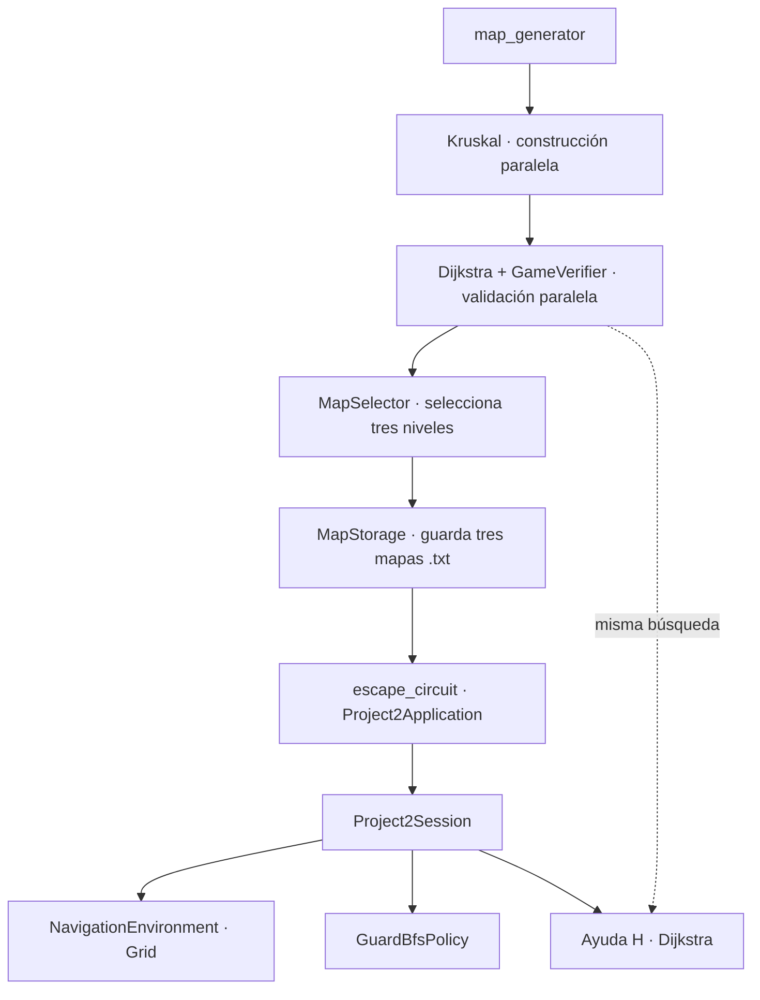

# Circuito de Escape — Maze

**Proyecto 2 · CS2013 Programación III · UTEC 2026-2**

Juego de terminal en C++20. Activa los interruptores A y B, evita al vigilante y llega a la salida con energía antes de superar el límite de turnos. El generador prepara tres mapas por separado. El juego carga el nivel elegido sin volver a generarlo.

[Descargas](#descargas-del-proyecto-2) · [Cómo jugar](#cómo-jugar) · [Mapas y algoritmos](#mapas-y-algoritmos) · [Arquitectura](#arquitectura-y-reutilización) · [Pruebas y rúbrica](#pruebas-y-rúbrica) · [Demostración](#demostración)

## Descargas del Proyecto 2

| Sistema | Instalador | Guía |
| --- | --- | --- |
| Windows x64 | [ZIP para Windows](https://github.com/leonardolandeo-a11y/Maze/releases/download/v1.0.0/CircuitoEscape-Windows-x64-Release.zip) | [Guía PDF](https://github.com/leonardolandeo-a11y/Maze/releases/download/v1.0.0/Guia_Instalacion_Maze.pdf) |
| Ubuntu 26.04 x86_64 | [ZIP para Ubuntu](https://github.com/leonardolandeo-a11y/Maze/releases/download/v1.0.0-linux/CircuitoEscape-Ubuntu-26.04-x86_64-Release.zip) | [Guía PDF](https://github.com/leonardolandeo-a11y/Maze/releases/download/v1.0.0-linux/Guia_Instalacion_Maze.pdf) |

Ambos paquetes incluyen `escape_circuit`, `map_generator`, tres mapas y las dependencias de ejecución. No requieren compilar. El recorrido de demostración de este README usa **Ubuntu 26.04 x86_64**. También se incluye el procedimiento en Windows.

<details>
<summary>Windows x64 · instalar, jugar y desinstalar</summary>

1. Extrae el ZIP y ejecuta `CircuitoEscape-Setup.exe`. Se instala para el usuario actual.
2. En **Inicio → Circuito de Escape**, abre **Jugar** para cargar los mapas incluidos.
3. Para crear otros mapas, abre **Generar mapas**, ingresa filas y columnas, y abre **Jugar mapas generados**. Los archivos quedan en `%LOCALAPPDATA%\CircuitoEscape\generated-maps`.
4. Cierra el juego con `Q` y ejecuta **Desinstalar** desde el mismo menú. Se conservan los mapas generados.

</details>

<details>
<summary>Ubuntu 26.04 x86_64 · instalar, jugar y desinstalar</summary>

Extrae el ZIP. Desde la carpeta que contiene `install.sh`, ejecuta:

```bash
bash install.sh
"$HOME/.local/bin/escape_circuit"
```

Para generar y jugar con otro lote, usa una carpeta nueva para no sobrescribir mapas previos:

```bash
MAPAS=$(mktemp -d "$HOME/CircuitoDemo.XXXXXX")
"$HOME/.local/bin/map_generator" --interactive --output "$MAPAS"
# Introduce las filas y columnas cuando el generador las solicite.
"$HOME/.local/bin/escape_circuit" --maps "$MAPAS"
```

Cierra con `Q` y desinstala con:

```bash
bash "$HOME/.local/opt/circuito-escape/install.sh" uninstall
```

El instalador trabaja en `~/.local`, sin `sudo`. Los mapas guardados fuera de la instalación se conservan.

</details>

## Cómo jugar

En **DIFFICULTY** elige Easy, Medium o Hard. **START GAME** carga el mapa del nivel y **RENDER MODE** permite alternar emoji y ASCII.

| Tecla | Acción |
| --- | --- |
| `W A S D` o flechas | Mover al jugador |
| `E` | Esperar un turno |
| `H` | Abrir o cerrar la ayuda de energía. `Esc` también la cierra |
| `1`, `2`, `3`, `0` | Dentro de H, resaltar ruta hacia A, hacia B, recorrido recomendado o ninguna |
| `Z` | Cambiar entre el mapa completo y la vista de detalle, incluso con H abierta |
| `Q` | Salir |

### Leyenda del tablero

| Celda o entidad | Modo emoji | Modo ASCII | Comportamiento |
| --- | :---: | :---: | --- |
| Jugador | 🤖 | `@` | Posición actual del jugador. |
| **Vigilante** | **👀** | **`V`** | Persigue al jugador con BFS y avanza un paso en los turnos pares. |
| Interruptor A | `A` / `a` | `A` / `a` | Mayúscula si está pendiente. Minúscula si ya fue activado. |
| Interruptor B | `B` / `b` | `B` / `b` | Mayúscula si está pendiente. Minúscula si ya fue activado. |
| Espacio libre | ⬜ | `.` | Casilla transitable de costo normal. |
| Muro | ⬛ | `#` | Bloquea el paso. |
| Terreno elevado | 🟫 | `~` | Gasta más energía al entrar. |
| Recurso | 💎 | `R` | Suma puntos una sola vez. |
| Batería | ⚡ | `+` | Recupera energía una sola vez, hasta el máximo. |
| Trampa | 💥 | `T` | Penaliza energía y puntaje cada vez que se entra. |
| Salida | 🏁 | `S` | Solo da la victoria con A y B activos, energía positiva y sin captura. |

El mapa completo compacto puede usar marcadores ASCII y colores para ahorrar espacio, incluso en modo emoji. La leyenda corresponde a [`escape_circuit`](src/console_ui.cpp). Los símbolos en pantalla no son los mismos que los del archivo de mapa.

Cada turno se resuelve así:

1. El motor aplica la acción del jugador, los costos y los efectos de la casilla.
2. Si no hubo captura por entrar a la casilla del vigilante, este puede avanzar en turnos pares. Busca desde su posición hasta la posición actual del jugador, respeta muros y desempata arriba, izquierda, derecha, abajo. Si no tiene camino, espera.
3. Se comprueba captura, luego energía, luego activación de interruptores y salida. Si no hubo victoria y se alcanzó el límite, la partida termina. **Se puede ganar en el último turno permitido**, pero la captura tiene prioridad.

## Mapas y algoritmos

### Preparación y selección

- **Construcción.** Kruskal ordena las aristas del grafo propio y usa `DisjointSet` para construir un árbol de costo mínimo sin ciclos. Las aperturas extra se agregan aparte.
- **Validación.** Dijkstra compara `Inicio → A → B → Salida` con `Inicio → B → A → Salida`. Si un tramo no existe, invalida ese recorrido. El costo de terreno se contrasta con la energía inicial. Si hacen falta recargas, el verificador comprueba la secuencia con las reglas reales, incluidas las baterías y el vigilante. Una ruta barata por sí sola no demuestra una victoria.
- **Selección.** Entre los candidatos con una victoria demostrada, Easy toma el menor costo y Hard el mayor. Medium toma el costo distinto de ambos extremos más cercano al promedio de los candidatos verificados. Desempata por menor identificador. Con menos de tres costos distintos, el generador informa el fallo y no guarda un lote incompleto.
- **Concurrencia.** Construcción y validación son dos fases separadas. Cada una usa un conjunto acotado de `std::jthread`, un contador atómico para repartir tareas y una posición de resultados por mapa. Todos los hilos de construcción terminan antes de validar. La clasificación es secuencial. Los errores se informan por mapa y se muestran tiempos separados de **Construction** y **Validation**.

### Ayuda durante la partida

Al abrir `H`, el juego reutiliza Dijkstra desde la posición actual. Omite los interruptores activos y muestra el camino recomendado, sus tramos, el costo total y el saldo de energía: positivo, cero o negativo. También indica cuando no hay recorrido válido. La consulta no mueve al vigilante, no consume energía y no avanza el turno. Es una estimación de gasto de terreno, no una simulación de capturas, recargas, trampas ni esperas.

### Mapas guardados

En [`assets/maps`](assets/maps) vienen `mapa_facil.txt`, `mapa_medio.txt` y `mapa_dificil.txt`. Para usar otro lote, indica su carpeta con `escape_circuit --maps DIR`. `--difficulty easy|medium|hard` permite abrir directamente un nivel. Si el lote está incompleto o es inválido, el juego informa el error en vez de regenerarlo.

El formato de texto [`CIRCUIT_ESCAPE_MAP 1`](src/map_generation/map_storage.cpp) guarda el ID, semilla, nivel, costo mínimo, dimensiones, energía, límite de turnos, posiciones y secuencia ganadora. En `cells`, `.` es paso libre, `#` muro y `E` salida. Los tipos con parámetros son `R:<costo>` (terreno), `P:<puntos>` (recurso), `B:<energía>` (batería) y `T:<energía>:<puntos>` (trampa). Jugador, vigilante y switches se guardan como coordenadas separadas, desde cero. La carga comprueba que las acciones guardadas reproduzcan una victoria.

| Mapa incluido (20×30) | ID | Semilla del candidato | Costo Dijkstra |
| --- | ---: | ---: | ---: |
| Easy | 3 | 3668352356 | 51 |
| Medium | 5 | 387289302 | 61 |
| Hard | 9 | 2415097786 | 76 |

<details>
<summary>Dimensiones, semillas y generación reproducible</summary>

Filas de 5 a 40, columnas de 5 a 60 y proporción `filas ≤ columnas ≤ 2 × filas`, con área máxima de 2400. Se admiten de 1 a 10 candidatos por lote y al menos un trabajador. `map_generator --help` enumera todas las opciones.

Desde una compilación local, este comando reproduce el lote incluido en una carpeta independiente:

```bash
./build/map_generator --rows 20 --columns 30 --seed 12345 --workers 4 \
  --candidates 10 --initial-energy 100 --maximum-energy 100 --turn-limit 240 \
  --extra-openings 15 --rough-percent 15 --rough-cost 2 --search-states 30000 \
  --resources 5 --resource-points 10 --batteries 3 --battery-recharge 5 \
  --traps 3 --trap-penalty 2 --trap-score-penalty 1 --output build/mapas-repro
./build/escape_circuit --maps build/mapas-repro --difficulty easy
```

Para comparar resultados, repite con la misma configuración, `--workers 1` y otra carpeta de salida. Compara los tres archivos, no los tiempos.

</details>

## Arquitectura y reutilización



Los dos ejecutables enlazan [`Maze_core`](CMakeLists.txt). FTXUI se dedica a la interfaz de terminal. Grafo, DisjointSet, Kruskal, Dijkstra y BFS se implementan en el proyecto.

| Componente del Proyecto 1 | Adaptación y uso en el Proyecto 2 | Evidencia |
| --- | --- | --- |
| `Grid`, `Position`, vecindad e iteradores | `Grid<Cell>` usa dimensiones en ejecución. Conserva coordenadas, acceso e iteradores y permite construir el grafo del escenario. | [Grid](tests/grid_test.cpp), [integración](tests/project2_integration_test.cpp) |
| `NavigationEnvironment`, `Agent` y `GameRules` | `Project2Session` delega movimiento, energía, efectos y reinicio al motor. Añade interruptores y reglas de persecución y salida. | [Motor](tests/environment_test.cpp), [interacciones](tests/interactions_test.cpp), [integración](tests/project2_integration_test.cpp) |
| `IController`, `NavigationPolicy` y `PolicyController` | El adaptador expone las acciones legales y una observación al vigilante con `GuardBfsPolicy`. | [Controladores](tests/controllers_test.cpp), [verificador](tests/map_generation/game_verifier_test.cpp) |
| `countMatching` y `LinearSearch` | Utilidades genéricas que siguen operando sobre iteradores de `Grid` para validar celdas y localizar la salida. | [Funciones genéricas](tests/generic_functions_test.cpp), [motor](tests/environment_test.cpp) |
| `ConsoleUI`, menús y FTXUI | Se añaden vistas FULL MAP / DETAIL, controles del Proyecto 2 y ayuda H sin reemplazar las animaciones del juego. | [Interfaz](tests/console_ui_test.cpp), [tamaños de terminal](tests/responsive_ui_test.cpp), [cinemáticas](tests/cinematic_sequence_test.cpp) |

<details>
<summary>Proyecto 1 y notas de diseño</summary>

La [primera entrega](https://github.com/leonardolandeo-a11y/Maze/tree/proyecto-1-entrega) conserva su documentación histórica. El ejecutable `Maze` sigue disponible al compilar desde el repositorio. Para el Proyecto 2 se recomienda `escape_circuit`.

El motor usa `CellTraits` y especializaciones para las celdas, `std::variant` para eventos, `std::visit` para procesarlos y policies intercambiables mediante `IController`. El concept `NavigationPolicy` exige que `selectAction` retorne `Action`. La [prueba negativa](tests/invalid_test.cpp) queda fuera del build normal. Al compilarla por separado debe fallar por no satisfacer el concept:

```bash
g++ -std=c++20 -Iinclude -fsyntax-only tests/invalid_test.cpp
```

</details>

## Compilar y ejecutar desde código

Requiere CMake 3.20 o posterior, Git, un compilador con C++20 y acceso a GitHub para descargar FTXUI 7.0.3 durante la primera configuración. Ejecuta desde la raíz del repositorio:

```bash
cmake -S . -B build -DCMAKE_BUILD_TYPE=Release
cmake --build build --config Release --parallel
ctest --test-dir build -C Release --output-on-failure
```

En Linux con un generador de CMake de configuración única:

```bash
./build/escape_circuit
./build/map_generator --help
```

En Windows con Visual Studio y PowerShell:

```powershell
.\build\Release\escape_circuit.exe
.\build\Release\map_generator.exe --help
```

Si usas Ninja/MinGW, los `.exe` quedan directamente en `build\`. Para reconstruir los paquetes se incluyen los scripts de [Windows](installer/windows/build-installer.ps1) y [Ubuntu](installer/linux/build-package.sh). Para instalar la versión publicada no es necesario reconstruirlos.

## Pruebas y rúbrica

La tabla resume los ocho criterios del enunciado oficial de **Proyecto 2, §9, p. 12**, y las evidencias mínimas de §7. CTest ejecuta `Maze_test`, que agrupa la suite completa y mantiene activas las aserciones incluso en Release.

| Criterio (máximo) | Comprobaciones cubiertas y dónde revisarlas |
| --- | --- |
| Reutilización (2) | Dimensiones sin perder la interfaz de Grid, motor con movimiento/energía/reinicio, controladores y utilidades genéricas, y [matriz de reutilización](#arquitectura-y-reutilización). |
| Grafo y Kruskal (3) | Grafo y DSU propios, árbol conectado de costo mínimo, aperturas separadas y semillas reproducibles. [Grafo](tests/graph_test.cpp) · [DSU](tests/graph/disjoint_set_test.cpp) · [Kruskal](tests/map_generation/kruskal_test.cpp). |
| Validación y dificultad (2) | Dos órdenes completos, tramos inaccesibles y energía/recargas, selección por costo y empates, rechazo de lotes sin tres costos ganadores. [Validador](tests/map_generation/map_validator_test.cpp) · [Selector](tests/map_generation/map_selector_test.cpp) · [Verificador](tests/map_generation/game_verifier_test.cpp). |
| Dijkstra y ayuda H (3) | Algoritmo propio compartido, omisión de interruptores activos, costos y saldos, actualización sin consumir turnos. [Dijkstra](tests/pathfinding/dijkstra_test.cpp) · [Integración](tests/project2_integration_test.cpp) · [Partidas en terminal](tests/delivery/terminal_playthrough.py). |
| Vigilante con BFS (2) | Camino con menos movimientos, recalcula al jugador actual, actúa en turnos pares, respeta muros, desempata y sabe esperar. [Controladores](tests/controllers_test.cpp) · [Reglas del vigilante](tests/map_generation/game_verifier_test.cpp). |
| Reglas y partida completa (2) | A/B persistentes, precedencia de captura, energía y último turno, reinicio y reproducción de una victoria guardada. [Integración](tests/project2_integration_test.cpp) · [Carga y reproducción](tests/map_generation/map_storage_test.cpp). |
| Concurrencia (4) | Construcción en paralelo, validación en paralelo después de la barrera, datos aislados y resultados iguales con 1/4 trabajadores, gestión de errores y tiempos separados. [Lotes concurrentes](tests/map_generation/map_batch_test.cpp). |
| Pruebas, entrega e instalador (2) | C++20 y CTest, paquetes con ambos ejecutables, instrucciones de instalación/compilación/semillas/desinstalación y [recorrido para mostrar preparación y partida](#demostración). [Aceptación del instalador Windows](tests/delivery/windows_acceptance.py) · [Ejecución aprobada en CI](https://github.com/leonardolandeo-a11y/Maze/actions/runs/43789385348). |

Las pruebas integradas incluyen generar, guardar, cargar y jugar en **10×15, 20×30 y 40×60**, validar entradas inválidas, reiniciar, esperar, quedarse sin energía y comprobar captura en la salida. Las pruebas de terminal y CI son evidencia técnica y no sustituyen la demostración del equipo.

## Demostración

1. Extrae e instala el [paquete de Ubuntu](#descargas-del-proyecto-2) sin recompilar. Abre una terminal amplia.
2. Usa el generador instalado con `--interactive`, ingresa **15 filas y 20 columnas**, y guarda en una carpeta nueva. Muestra los tiempos de ambas fases y los tres archivos resultantes.
3. Abre ese mismo lote con `escape_circuit --maps "$MAPAS" --difficulty easy` usando el lanzador instalado. Pulsa Enter en WELCOME. Abre `H` para mostrar el recorrido y su costo, y comprueba que consultar la ayuda no avanza el turno.
4. Activa B y A, vuelve a abrir `H` para mostrar que omite los objetivos ya activos y termina con **VICTORY**.
5. Sal con `Q`, desinstala y comprueba que siguen existiendo los mapas generados.

<details>
<summary>Secuencia de ensayo para el mapa fácil 15×20</summary>

Para el lote generado con el perfil interactivo, semilla base **12345** y mapa fácil **ID 10**, estas son las teclas de la secuencia guardada. Presiónalas una por una, sin los espacios ni Enter, y cierra H antes de continuar.

| Resultado | Teclas |
| --- | --- |
| Turno 8 · B activado | `wwwwww aa` |
| Turno 18 · A activado | `dd ssss aaaa` |
| Turno 28 · Victoria | `aa ss dd ssss` |

</details>

## Equipo

| Integrante | Aportes principales |
| --- | --- |
| [Leonardo Landeo](https://github.com/leonardolandeo-a11y) | Estructura inicial, tablero, reglas, integración de interfaz y ciclo de juego. |
| [Fabricio Nick](https://github.com/SRHOUSE) | Motor de navegación, observaciones y resultados, simulación, pruebas y animaciones. |
| [André Mejía](https://github.com/andremejia-hub) | Costos de movimiento, concept de políticas, escenarios y pruebas del motor. |
| [Jared Chala](https://github.com/jaredchala-bot) | Interacciones, adaptador de políticas, ayuda e interfaz, templates y pruebas. |
| [Iker García](https://github.com/iygt8-iterate) | Interfaz de controladores, renderizado, navegación de menús y documentación. |

El detalle de aportes y los registros anteriores se conservan en el [historial previo a la consolidación](https://github.com/leonardolandeo-a11y/Maze/tree/fa2342014c3c6353d3350455156063c2b9354f61/docs).
