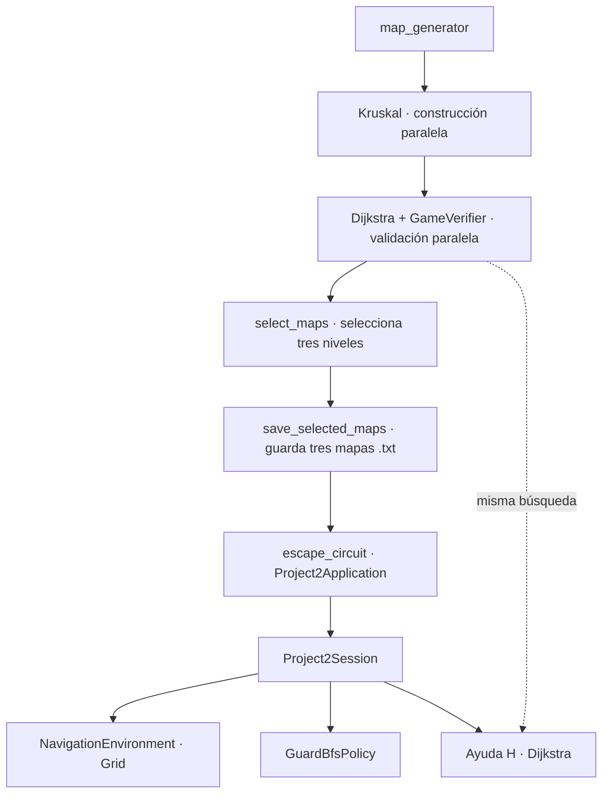

# Circuito de Escape — Maze

**Proyecto 2 · CS2013 Programación III · UTEC 2026-2**

Juego de terminal en C++20. Activa los interruptores A y B, evita al vigilante y llega a la salida con energía antes de superar el límite de turnos. El generador prepara tres mapas por separado. El juego carga el nivel elegido sin volver a generarlo.

[Descargas](#descargas-del-proyecto-2) · [Cómo jugar](#cómo-jugar) · [Mapas y algoritmos](#mapas-y-algoritmos) · [Arquitectura](#arquitectura-y-reutilización) · [Pruebas y rúbrica](#pruebas-y-rúbrica) · [Demostración](#demostración)

Documentación complementaria: [diseño y temas académicos](docs/design.md), [contribuciones](docs/contributions.md) y [diagrama editable](docs/architecture/circuito-escape.dot).

## Descargas del Proyecto 2

| Sistema | Instalador | Guía |
| --- | --- | --- |
| Windows x64 | [ZIP para Windows](https://github.com/leonardolandeo-a11y/Maze/releases/download/v1.0.0/CircuitoEscape-Windows-x64-Release.zip) | [Guía PDF](https://github.com/leonardolandeo-a11y/Maze/releases/download/v1.0.0/Guia_Instalacion_Maze.pdf) |
| Ubuntu 26.04 x86_64 | [ZIP para Ubuntu](https://github.com/leonardolandeo-a11y/Maze/releases/download/v1.0.0-linux/CircuitoEscape-Ubuntu-26.04-x86_64-Release.zip) | [Guía PDF](https://github.com/leonardolandeo-a11y/Maze/releases/download/v1.0.0-linux/Guia_Instalacion_Maze.pdf) |

Los paquetes permiten ejecutar `escape_circuit` y `map_generator` sin compilar e incluyen los mapas y las dependencias de ejecución. El procedimiento de demostración descrito aquí utiliza **Ubuntu 26.04 x86_64**. También se incluyen instrucciones para Windows.

Las descargas [`v1.0.0`](https://github.com/leonardolandeo-a11y/Maze/releases/tag/v1.0.0) y [`v1.0.0-linux`](https://github.com/leonardolandeo-a11y/Maze/releases/tag/v1.0.0-linux) están marcadas como *prerelease* y sus tags apuntan a `b313aab`. El manifiesto `BUILD-INFO.txt` del paquete Ubuntu identifica su compilación como `6a2c76d`. Para reproducir una entrega, conserva la versión del paquete y sus mapas; los ejemplos de compilación desde código corresponden a la versión del repositorio que hayas clonado.

<details>
<summary>Windows x64 · instalar, jugar y desinstalar</summary>

1. Extrae el ZIP y ejecuta `CircuitoEscape-Setup.exe`. Se instala para el usuario actual.
2. En **Inicio → Circuito de Escape**, abre **Jugar** para cargar los mapas incluidos.
3. Para crear otros mapas, abre **Generar mapas**, ingresa filas y columnas, y abre **Jugar mapas generados**. Los archivos quedan en `%LOCALAPPDATA%\CircuitoEscape\generated-maps`.
4. Cierra el juego con `Q` y ejecuta **Desinstalar** desde el mismo menú. Se conservan los mapas generados.

</details>

<details>
<summary>Ubuntu 26.04 x86_64 · instalar, jugar y desinstalar</summary>

Extrae el ZIP. Desde la carpeta que contiene `install.sh`, ejecuta:

```bash
bash install.sh
"$HOME/.local/bin/escape_circuit"
```

Para generar y jugar con otro lote, usa una carpeta nueva para no sobrescribir mapas previos:

```bash
MAPAS=$(mktemp -d "$HOME/CircuitoDemo.XXXXXX")
"$HOME/.local/bin/map_generator" --interactive --output "$MAPAS"
# Introduce las filas y columnas cuando el generador las solicite.
"$HOME/.local/bin/escape_circuit" --maps "$MAPAS"
```

Cierra con `Q` y desinstala con:

```bash
bash "$HOME/.local/opt/circuito-escape/install.sh" uninstall
```

El instalador trabaja en `~/.local`, sin `sudo`. Los mapas guardados fuera de la instalación se conservan.

</details>

## Cómo jugar

En **DIFFICULTY** elige Easy, Medium o Hard. **START GAME** carga el mapa del nivel y **RENDER MODE** permite alternar emoji y ASCII.

| Tecla | Acción |
| --- | --- |
| `W A S D` o flechas | Mover al jugador |
| `E` | Esperar un turno |
| `H` | Abrir o cerrar la ayuda de energía. `Esc` también la cierra |
| `1`, `2`, `3`, `0` | Dentro de H, resaltar ruta hacia A, hacia B, recorrido recomendado o ninguna |
| `Z` | Cambiar entre el mapa completo y la vista de detalle, incluso con H abierta |
| `Q` | Salir |

### Leyenda del tablero

| Celda o entidad | Modo emoji | Modo ASCII | Comportamiento |
| --- | :---: | :---: | --- |
| Jugador | 🤖 | `@` | Posición actual del jugador. |
| **Vigilante** | **👀** | **`V`** | Persigue al jugador con BFS y avanza un paso en los turnos pares. |
| Interruptor A | `A` / `a` | `A` / `a` | Mayúscula si está pendiente. Minúscula si ya fue activado. |
| Interruptor B | `B` / `b` | `B` / `b` | Mayúscula si está pendiente. Minúscula si ya fue activado. |
| Espacio libre | ⬜ | `.` | Casilla transitable de costo normal. |
| Muro | ⬛ | `#` | Bloquea el paso. |
| Terreno elevado | 🟫 | `~` | Gasta más energía al entrar. |
| Recurso | 💎 | `R` | Suma puntos una sola vez. |
| Batería | ⚡ | `+` | Recupera energía una sola vez, hasta el máximo. |
| Trampa | 💥 | `T` | Penaliza energía y puntaje cada vez que se entra. |
| Salida | 🏁 | `S` | Solo da la victoria con A y B activos, energía positiva y sin captura. |

El mapa completo compacto puede usar marcadores ASCII y colores para ahorrar espacio, incluso en modo emoji. La leyenda corresponde a [`escape_circuit`](src/console_ui.cpp). Los símbolos en pantalla no son los mismos que los del archivo de mapa.

Cada turno se resuelve así:

1. El motor aplica la acción del jugador, los costos y los efectos de la casilla.
2. Si no hubo captura por entrar a la casilla del vigilante, este puede avanzar en turnos pares. Busca desde su posición hasta la posición actual del jugador, respeta muros y desempata arriba, izquierda, derecha, abajo. Si no tiene camino, espera.
3. Se comprueba captura, luego energía, luego activación de interruptores y salida. Si no hubo victoria y se alcanzó el límite, la partida termina. **Se puede ganar en el último turno permitido**, pero la captura tiene prioridad.

Esperar o intentar moverse contra un muro o fuera del tablero consume un turno y el costo de espera del mapa. Los interruptores permanecen activos. La energía se limita entre cero y el máximo; una batería se aplica después del costo de entrada, antes de evaluar la derrota. Las teclas de consulta H/Z no cuentan como acciones de movimiento.

## Mapas y algoritmos

### Preparación y selección

- **Construcción.** Kruskal ordena las aristas del grafo propio y usa `DisjointSet` para construir un árbol de costo mínimo sin ciclos. Las aperturas extra se agregan aparte.
- **Validación.** Dijkstra compara `Inicio → A → B → Salida` con `Inicio → B → A → Salida`. Si un tramo no existe, invalida ese recorrido. El costo de terreno se contrasta con la energía inicial. Si hacen falta recargas, el verificador comprueba la secuencia con las reglas reales, incluidas las baterías y el vigilante. Una ruta barata por sí sola no demuestra una victoria.
- **Selección.** Entre los candidatos con una victoria demostrada, Easy toma el menor costo y Hard el mayor. Medium toma el costo distinto de ambos extremos más cercano al promedio de los candidatos verificados. Desempata por menor identificador. Con menos de tres costos distintos, el generador informa el fallo y no guarda un lote incompleto.
- **Concurrencia.** Construcción y validación son dos fases separadas. Cada una usa un conjunto acotado de `std::jthread`, un contador atómico para repartir tareas y una posición de resultados por mapa. Todos los hilos de construcción terminan antes de validar. La clasificación es secuencial. Los errores se informan por mapa y se muestran tiempos separados de **Construction** y **Validation**.

### Ayuda durante la partida

Al abrir `H`, el juego reutiliza Dijkstra desde la posición actual. Omite los interruptores activos y muestra el camino recomendado, sus tramos, el costo total y el saldo de energía: positivo, cero o negativo. También indica cuando no hay recorrido válido. La consulta no mueve al vigilante, no consume energía y no avanza el turno. Es una estimación de gasto de terreno, no una simulación de capturas, recargas, trampas ni esperas.

### Mapas guardados

En [`assets/maps`](assets/maps) vienen `mapa_facil.txt`, `mapa_medio.txt` y `mapa_dificil.txt`. Para usar otro lote, indica su carpeta con `escape_circuit --maps DIR`. `--difficulty easy|medium|hard` permite abrir directamente un nivel. Si el lote está incompleto o es inválido, el juego informa el error en vez de regenerarlo.

El formato de texto [`CIRCUIT_ESCAPE_MAP 1`](src/map_generation/map_storage.cpp) guarda el ID, semilla, nivel, costo mínimo, dimensiones, energía, límite de turnos, posiciones y secuencia ganadora. En `cells`, `.` es paso libre, `#` muro y `E` salida. Los tipos con parámetros son `R:<costo>` (terreno), `P:<puntos>` (recurso), `B:<energía>` (batería) y `T:<energía>:<puntos>` (trampa). Jugador, vigilante y switches se guardan como coordenadas separadas, desde cero. La carga comprueba que las acciones guardadas reproduzcan una victoria.

Los campos aparecen en este orden; los valores entre `<...>` son marcadores descriptivos, no un archivo listo para cargar. Cada fila de `cells` contiene exactamente tantas celdas separadas por espacios como columnas tenga el mapa:

```text
CIRCUIT_ESCAPE_MAP 1
id <entero positivo>
seed <semilla del candidato uint32>
difficulty <easy|medium|hard>
minimum_energy_cost <costo Dijkstra de ambos objetivos y salida>
dimensions <filas> <columnas>
energy <inicial> <máxima>
turn_limit <turnos>
player <fila> <columna>
guard <fila> <columna>
switch_a <fila> <columna>
switch_b <fila> <columna>
exit <fila> <columna>
effects <recarga de batería> <penalización de trampa> <costo de espera>
actions <cantidad> <acciones separadas por espacios>
cells
<filas de tokens de celda>
end
```

Las acciones serializadas son `U`, `D`, `L`, `R`, `W` (arriba, abajo, izquierda, derecha, esperar); `W` en el archivo corresponde a la tecla `E`, no a la tecla de subir. No se admiten comentarios ni campos adicionales. El cargador comprueba una salida, posiciones distintas y transitables, coherencia de efectos, costo mínimo recalculado y victoria exacta de la secuencia. El archivo completo [mapa_facil.txt](assets/maps/mapa_facil.txt) sirve de ejemplo válido. Los archivos `scenario_01.txt` y `scenario_02.txt` son recursos históricos; no usan este formato ni son los tres niveles de `escape_circuit`.

| Mapa incluido (20×30) | ID | Semilla del candidato | Costo Dijkstra |
| --- | ---: | ---: | ---: |
| Easy | 3 | 3668352356 | 51 |
| Medium | 5 | 387289302 | 61 |
| Hard | 9 | 2415097786 | 76 |

<details>
<summary>Dimensiones, semillas y generación reproducible</summary>

Filas de 5 a 40, columnas de 5 a 60 y proporción `filas ≤ columnas ≤ 2 × filas`, con área máxima de 2400. Se admiten de 1 a 10 candidatos por lote y al menos un trabajador. `map_generator --help` enumera todas las opciones.

Desde una compilación local, este comando reproduce el lote incluido en una carpeta independiente:

```bash
./build/map_generator --rows 20 --columns 30 --seed 12345 --workers 4 \
  --candidates 10 --initial-energy 100 --maximum-energy 100 --turn-limit 240 \
  --extra-openings 15 --rough-percent 15 --rough-cost 2 --search-states 30000 \
  --resources 5 --resource-points 10 --batteries 3 --battery-recharge 5 \
  --traps 3 --trap-penalty 2 --trap-score-penalty 1 --output build/mapas-repro
./build/escape_circuit --maps build/mapas-repro --difficulty easy
```

Para comparar resultados, repite con la misma configuración, `--workers 1` y otra carpeta de salida. Compara los tres archivos, no los tiempos.

```bash
for nivel in facil medio dificil; do
  cmp "build/mapas-repro/mapa_${nivel}.txt" "build/mapas-repro-1/mapa_${nivel}.txt"
done
```

La segunda carpeta supone que repetiste el comando con `--output build/mapas-repro-1`. Con la misma versión y configuración, los archivos deben coincidir independientemente del número de trabajadores. La semilla base no es la semilla de cada candidato: el lote deriva esta última del ID. Reproducir requiere conservar también versión y parámetros.

</details>

### Parámetros y costos

| Configuración | CLI sin `--interactive` | Perfil interactivo |
| --- | --- | --- |
| Dimensiones | 10×15; `--rows`, `--columns` | Solicitadas al usuario |
| Semilla base | 12345; `--seed` | 42 para 40×60; 12345 en los demás tamaños |
| Candidatos / trabajadores | 10 / 4; `--candidates`, `--workers` | 10 / 4 |
| Energía inicial / máxima | 100 / 100 | 1000 / 1000 |
| Límite de turnos | 150 | 2000 |
| Aperturas adicionales | 4 | 15 |
| Terreno elevado | 15% de posiciones disponibles, costo 2 | Igual |
| Recursos / baterías / trampas | 0 / 0 / 0 | 0 / 0 / 0 |
| Puntos por recurso / recarga | 10 / 3 | Igual, si hubiera esos ítems |
| Penalización de trampa: energía / puntos | 2 / 1 | Igual, si hubiera trampas |
| Presupuesto de estados | 20000 | 100 |

El modo interactivo acepta `--output` y obtiene los demás valores de [`project2_batch_config`](src/project2_generation.cpp); no se combina con las opciones numéricas del modo normal. Usa siempre `--output` para evitar sustituir `assets/maps`, que es el destino predeterminado. Los rangos y opciones se consultan con `--help`. El CLI retorna 0 al guardar el lote, 1 ante errores de entrada/ejecución y 2 si faltan tres costos ganadores distintos.

En Proyecto 2, entrar en una celda normal cuesta 1; el terreno usa `R:<costo>`. Espera y movimiento inválido usan el tercer valor de `effects` (1 en los mapas generados). Recursos suman puntos; baterías recargan hasta el máximo; las trampas suman su penalización al costo de entrada. Los valores se guardan en el escenario: elegir dificultad selecciona otro mapa, no aplica los perfiles de energía del Proyecto 1.

## Arquitectura y reutilización



Los dos ejecutables enlazan [`Maze_core`](CMakeLists.txt). FTXUI se dedica a la interfaz de terminal. Grafo, DisjointSet, Kruskal, Dijkstra y BFS se implementan en el proyecto.

El [diagrama completo en SVG](docs/architecture/circuito-escape.svg) y su [fuente DOT editable](docs/architecture/circuito-escape.dot) amplían este resumen con carga, verificación, grafo y componentes reutilizados. Las etiquetas designan funciones o módulos; no existen clases `MapSelector` o `MapStorage`.

| Componente original | Adaptación | Uso actual | Prueba |
| --- | --- | --- | --- |
| `Grid`, `Position`, vecindad e iteradores | Especialización dinámica `Grid<Cell>`; se conserva la variante estática. | `graph_from_grid` y tablero de `NavigationEnvironment<>`. | [Grid](tests/grid_test.cpp), [generación por tamaños](tests/project2_generation_test.cpp) |
| `NavigationEnvironment`, `Agent`, `GameRules` | Terminación diferida y valores de las celdas guardadas. | `Project2Session::step/reset` delega movimiento, energía, efectos y reinicio; añade interruptores y captura. | [Motor](tests/environment_test.cpp), [interacciones](tests/interactions_test.cpp), [paridad](tests/project2_integration_test.cpp) |
| `IController`, `NavigationPolicy`, `PolicyController` | Nueva política `GuardBfsPolicy` bajo el mismo contrato de acciones. | `GameVerifier::next_guard_position`, compartido con la sesión interactiva. | [Controladores](tests/controllers_test.cpp), [verificador](tests/map_generation/game_verifier_test.cpp) |
| `countMatching`, `LinearSearch` | Operan también sobre iteradores del tablero dinámico. | Validación de salida única y localización de salida en `NavigationEnvironment`. | [Funciones genéricas](tests/generic_functions_test.cpp), [motor](tests/environment_test.cpp) |
| `ConsoleUI`, menús y animaciones | HUD con interruptores/vigilante, ayuda H, FULL MAP/DETAIL y presentación adaptable. | `Project2Application` presenta mapas preparados y encadena cinemáticas con resultados. | [Interfaz](tests/console_ui_test.cpp), [tamaños de terminal](tests/responsive_ui_test.cpp), [cinemáticas](tests/cinematic_sequence_test.cpp) |

Decisiones principales: el tablero dinámico usa `std::vector` por sus dimensiones en ejecución; las adyacencias y rutas usan vectores indexados, BFS una FIFO y Dijkstra una cola de prioridad. `std::variant` representa celdas/eventos y `std::optional` expresa ausencia de ruta o selección. Separar preparación y juego permite guardar una victoria verificable y mantener H como consulta sin turnos. El [diseño técnico](docs/design.md#contenedores-y-temas-de-c) localiza templates, especializaciones, concepts, polimorfismo y eventos en el código.

<details>
<summary>Proyecto 1 y notas de diseño</summary>

La [primera entrega](https://github.com/leonardolandeo-a11y/Maze/tree/proyecto-1-entrega) conserva su documentación histórica. El ejecutable `Maze` sigue disponible al compilar desde el repositorio. Para el Proyecto 2 se recomienda `escape_circuit`.

Los perfiles heredados de [`rulesFor`](src/game_rules.cpp) son `easy` (energía 80, límite 240), `standard` (60, 180) y `hard` (40, 140); no clasifican los mapas generados. La simulación reproducible `runRandomSimulation(environment, seed)` se conserva en [simulation.h](include/circuit_escape/simulation.h) y sus [pruebas](tests/simulation_test.cpp).

El motor usa `CellTraits` y especializaciones para las celdas, `std::variant` para eventos, `std::visit` para procesarlos y policies intercambiables mediante `IController`. El concept `NavigationPolicy` exige que `selectAction` retorne `Action`. La [prueba negativa](tests/invalid_test.cpp) queda fuera del build normal. Al compilarla por separado debe fallar por no satisfacer el concept:

```bash
g++ -std=c++20 -Iinclude -fsyntax-only tests/invalid_test.cpp
```

</details>

## Compilar y ejecutar desde código

Requiere CMake 3.20 o posterior, Git, un compilador con C++20 y acceso a GitHub para descargar FTXUI 7.0.3 durante la primera configuración. Desde un clon limpio:

```bash
git clone https://github.com/leonardolandeo-a11y/Maze.git
cd Maze
cmake -S . -B build -DCMAKE_BUILD_TYPE=Release
cmake --build build --config Release --parallel
ctest --test-dir build -C Release --output-on-failure
```

En Linux con un generador de CMake de configuración única:

```bash
./build/escape_circuit
./build/map_generator --help
```

En Windows con Visual Studio y PowerShell:

```powershell
.\build\Release\escape_circuit.exe
.\build\Release\map_generator.exe --help
```

Si usas Ninja/MinGW, los `.exe` quedan directamente en `build\`. Para reconstruir los paquetes se incluyen los scripts de [Windows](installer/windows/build-installer.ps1) y [Ubuntu](installer/linux/build-package.sh). Para instalar la versión publicada no es necesario reconstruirlos.

**macOS:** no hay instalador y la compatibilidad está pendiente de validación. Con Git, CMake y un compilador AppleClang/Clang con soporte C++20, los comandos de configuración, compilación, CTest y `./build/escape_circuit` son el procedimiento propuesto; deben validarse en un Mac antes de declarar compatibilidad. La automatización de Windows utiliza MinGW/UCRT64; la compilación con Visual Studio requiere validación independiente.

## Pruebas y rúbrica

El proyecto cuenta con pruebas automatizadas ejecutadas mediante CTest a través del ejecutable `Maze_test`, con aserciones activas también en modo Release. La siguiente matriz relaciona las 32 comprobaciones de los ocho criterios de evaluación con su implementación y las pruebas correspondientes.

| ID / criterio | Comprobación | Implementación y pruebas asociadas |
| --- | --- | --- |
| R1 · Reutilización (2) | Grid configurable conserva Position, vecindad e iteradores | [grid_test](tests/grid_test.cpp), [project2_generation_test](tests/project2_generation_test.cpp): 10×15, 20×30 y 40×60 |
| R2 | Motor conserva movimiento, energía y reset | [environment_test](tests/environment_test.cpp), [paridad de sesión](tests/project2_integration_test.cpp) |
| R3 | Controladores adaptados y utilidad genérica utilizada | [controllers_test](tests/controllers_test.cpp), [generic_functions_test](tests/generic_functions_test.cpp); uso en motor y verificador |
| R4 | README identifica adaptación, uso y prueba | [Tabla de reutilización](#arquitectura-y-reutilización) |
| K1 · Grafo y Kruskal (3) | Grafo y DisjointSet propios | [graph_test](tests/graph_test.cpp), [disjoint_set_test](tests/graph/disjoint_set_test.cpp) |
| K2 | Árbol conectado, sin ciclos y mínimo | [kruskal_test](tests/map_generation/kruskal_test.cpp): Prim independiente y costo conocido |
| K3 | Aperturas adicionales separadas del árbol | `tree_openings` / `extra_openings`, `test_seed_and_extra_paths` |
| K4 | Misma semilla reproduce el mapa | Pruebas de Kruskal y comparación binaria del lote documentado |
| V1 · Validación y dificultad (2) | Dijkstra compara ambos recorridos completos | [map_validator_test](tests/map_generation/map_validator_test.cpp): A→B, B→A y un solo orden accesible |
| V2 | Tramos inaccesibles, energía y recargas | Validador: diagnósticos y umbrales; [game_verifier_test](tests/map_generation/game_verifier_test.cpp): desvío por batería |
| V3 | Clasificación por costos, promedio y desempates | [map_selector_test](tests/map_generation/map_selector_test.cpp): extremos, promedio decimal y menor ID |
| V4 | Victoria por nivel; rechazo sin tres costos distintos | `validate_map`, selector y [generación por tamaños](tests/project2_generation_test.cpp); CLI con un candidato |
| H1 · Dijkstra y H (3) | Dijkstra propio compartido entre preparación y ayuda | [dijkstra_test](tests/pathfinding/dijkstra_test.cpp), `validate_map_routes`, `help_report` |
| H2 | Compara ambos órdenes y omite switches activos | [project2_dijkstra_help_progression_test](tests/project2_integration_test.cpp), [terminal](tests/delivery/terminal_playthrough.py) |
| H3 | Costos y saldo suficiente, cero e insuficiente | `format_project2_help_lines`; [project2_active_help_text_test](tests/project2_integration_test.cpp) |
| H4 | Ayuda actualizada sin consumir turnos | Handler H/Esc en [aplicación](src/project2_application.cpp), prueba de terminal |
| B1 · Vigilante BFS (2) | BFS propio minimiza movimientos | [controllers_test](tests/controllers_test.cpp): ruta mínima y desvíos |
| B2 | Recalcula hacia el jugador actual | Controladores: cambio de objetivo; `next_guard_position(guard, player)` |
| B3 | Movimiento solo en turnos pares | [guard_even_turn_capture_test](tests/map_generation/game_verifier_test.cpp) y `Project2Session::step` |
| B4 | Muros, desempate fijo y espera sin camino | Controladores: desvío, empate y desconexión |
| P1 · Reglas y partida (2) | A/B persistentes y necesarios para escapar | [game_verifier_test](tests/map_generation/game_verifier_test.cpp): ambos órdenes y salida anticipada |
| P2 | Captura prioritaria al escape | `capture_priority_test`, `capture_on_enabled_exit_test` |
| P3 | Energía y límite, incluido el último turno | `limit_and_wait_test`, pruebas del motor y paridad de sesión |
| P4 | Reset correcto y victoria guardada reproducida | [environment_test](tests/environment_test.cpp), [paridad de sesión](tests/project2_integration_test.cpp) y [map_storage_test](tests/map_generation/map_storage_test.cpp): reinicio, guardado, carga y reproducción |
| C1 · Concurrencia (4) | Construcción realmente paralela | [parallel_for / run_map_batch](src/map_generation/map_batch.cpp); pruebas con varios trabajadores |
| C2 | Validación paralela después de construcción | Dos llamadas separadas y destrucción/join de `std::jthread` |
| C3 | Escrituras protegidas y reproducibilidad 1/N | Slots exclusivos, contador atómico; [deterministic_workers_test](tests/map_generation/map_batch_test.cpp), comparación de archivos con 1/4 trabajadores |
| C4 | Errores por mapa y tiempos separados | Pruebas de lotes, rechazos por candidato y salida Construction/Validation del CLI |
| E1 · Pruebas y entrega (2) | CMake/C++20 y pruebas automatizadas | [CMakeLists](CMakeLists.txt), [test_main](tests/test_main.cpp) y [workflow Windows](.github/workflows/windows-delivery.yml) |
| E2 | Instalar, jugar y generar sin compilar | [Instalador Ubuntu](installer/linux/install.sh), [instalador Windows](installer/windows/CircuitEscape.nsi) y [aceptación Windows](tests/delivery/windows_acceptance.py) |
| E3 | README cubre compilación, pruebas, instalación, ejecución, semillas y desinstalación | Secciones prácticas y comandos de este documento |
| E4 | Demostrar preparación y partida completa | Generación interactiva 15×20, victorias en terminal y [procedimiento](#demostración) |

Las pruebas cubren la generación y validación de mapas, los algoritmos de búsqueda, la gestión de energía, las dimensiones configurables, la clasificación de dificultad, las reglas de juego, la persistencia y la concurrencia. Se ejecutan mediante CTest.

### Pruebas de terminal

La prueba adicional de terminal requiere Python con `pyte==0.8.2` y `pexpect` en Linux. No forma parte de CTest. Desde la raíz, con esas dependencias disponibles:

```bash
python3 tests/delivery/terminal_playthrough.py --exe build/escape_circuit \
  --maps assets/maps --evidence build/evidencia-terminal
```

En Windows, [windows_acceptance.py](tests/delivery/windows_acceptance.py) comprueba el instalador y los binarios mediante ConPTY. El [workflow de entrega](.github/workflows/windows-delivery.yml) configura las dependencias y conserva los resultados como artefactos de la ejecución correspondiente.

## Demostración

Utiliza el mismo paquete y lote de mapas durante toda la demostración. Conserva su identificación de versión junto con los resultados de las pruebas.

1. Extrae e instala el [paquete de Ubuntu](#descargas-del-proyecto-2) sin recompilar. Abre una terminal amplia.
2. Usa el generador instalado con `--interactive`, ingresa **15 filas y 20 columnas**, y guarda en una carpeta nueva. Muestra los tiempos de ambas fases y los tres archivos resultantes.
3. Abre ese mismo lote con `escape_circuit --maps "$MAPAS" --difficulty easy` usando el lanzador instalado. Pulsa Enter en WELCOME. Abre `H` para mostrar el recorrido y su costo, y comprueba que consultar la ayuda no avanza el turno.
4. Activa B y A, vuelve a abrir `H` para mostrar que omite los objetivos ya activos y termina con **VICTORY**.
5. Sal con `Q`, desinstala y comprueba que siguen existiendo los mapas generados.

<details>
<summary>Secuencia de ensayo para el mapa fácil 15×20</summary>

Para el lote generado con el perfil interactivo, semilla base **12345** y mapa fácil **ID 10**, estas son las teclas de la secuencia guardada. Presiónalas una por una, sin los espacios ni Enter, y cierra H antes de continuar.

| Resultado | Teclas |
| --- | --- |
| Turno 8 · B activado | `wwwwww aa` |
| Turno 18 · A activado | `dd ssss aaaa` |
| Turno 28 · Victoria | `aa ss dd ssss` |

</details>

## Equipo

| Integrante | Código universitario | Aportes principales |
| --- | --- | --- |
| [Leonardo Landeo](https://github.com/leonardolandeo-a11y) | 202520151 | Base del tablero y reglas; DisjointSet, selector, interfaz, paquetes y documentación de entrega. |
| [Fabricio Nick](https://github.com/SRHOUSE) | 202520045 | Motor y simulación; generación, búsqueda de rutas/victorias, concurrencia, persistencia e integración del juego. |
| [André Mejía](https://github.com/andremejia-hub) | 202520185 | Costos, concept y escenarios; grafo, colocación de objetivos y pruebas asociadas. |
| [Jared Chala](https://github.com/jaredchala-bot) | 202520040 | Interacciones, adaptador y templates; HUD, ayuda energética, rutas y pruebas de presentación. |
| [Iker García](https://github.com/iygt8-iterate) | 202520059 | Controladores y menús; flujo offline, presentación adaptable, restauración de cinemáticas y documentación. |

El detalle actualizado y sus referencias están en [docs/contributions.md](docs/contributions.md).

## Limitaciones técnicas

- La generación de mapas está condicionada por las dimensiones, la semilla y los parámetros de configuración.
- La ayuda energética proporciona una estimación del recorrido, sin garantizar el éxito de la partida.
- La presentación visual del juego depende de las dimensiones y capacidades de la terminal.

## Referencias y dependencias de terceros

- [FTXUI v7.0.3](https://github.com/ArthurSonzogni/FTXUI/tree/v7.0.3): interfaz de terminal; [licencia MIT](https://github.com/ArthurSonzogni/FTXUI/blob/v7.0.3/LICENSE). CMake obtiene la versión fijada mediante FetchContent.
- [CMake](https://cmake.org/) y compilador C++20: herramientas de construcción. Graphviz se usa únicamente para regenerar la imagen de arquitectura; no es dependencia del juego.
- [NSIS](https://nsis.sourceforge.io/): empaquetado Windows; el [workflow](.github/workflows/windows-delivery.yml) utiliza MinGW/UCRT64 y Python con `pywinpty`/`pyte` para aceptación. La prueba de terminal en Linux usa `pexpect` y `pyte`; no son necesarios para jugar ni para CTest.
- Los paquetes Linux incluyen los avisos de FTXUI, glibc, libgcc y libstdc++ en `licenses/`.
- Requisitos académicos: extractos de Proyecto 2, Canvas y Proyecto 1 suministrados para el [Issue #150](https://github.com/leonardolandeo-a11y/Maze/issues/150), en ese orden de prioridad. La documentación sigue esa prioridad cuando existen diferencias entre las entregas.
