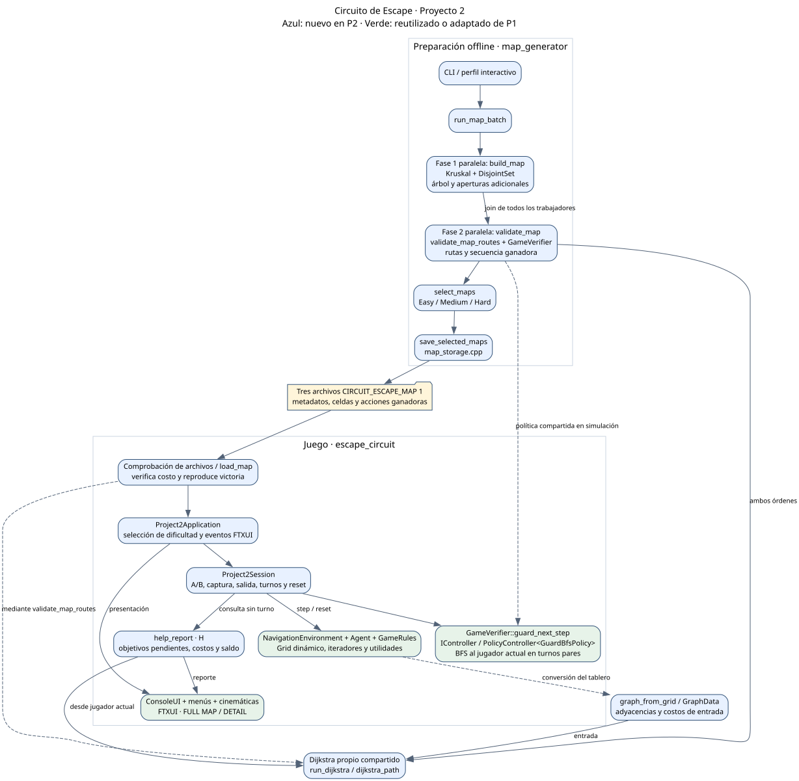

# Diseño técnico — Circuito de Escape

Este documento describe la arquitectura y las decisiones de diseño del Proyecto 2. El [README](../README.md) contiene los comandos, las reglas, la matriz de reutilización y la correspondencia entre requisitos y pruebas.

## Arquitectura y flujos



La [fuente editable DOT](architecture/circuito-escape.dot) representa módulos y llamadas, no una jerarquía de clases. Se puede regenerar con Graphviz:

```bash
dot -Tsvg docs/architecture/circuito-escape.dot -o docs/architecture/circuito-escape.svg
```

Los ejecutables `map_generator`, `escape_circuit` y el heredado `Maze` enlazan `Maze_core` en [CMake](../CMakeLists.txt). FTXUI participa en la presentación; los algoritmos no necesitan una terminal para ejecutar sus pruebas. El enlace común a FTXUI no significa que el generador abra una interfaz gráfica.

| Componente | Responsabilidad y relación con el resto |
| --- | --- |
| [CLI del generador](../src/map_generation/map_generator_cli.cpp) | Lee parámetros o dimensiones interactivas, ejecuta el lote y publica diagnósticos y archivos. |
| [Lote](../src/map_generation/map_batch.cpp) | Construye candidatos, valida rutas y victorias en dos fases, y entrega candidatos al selector. |
| [Persistencia](../src/map_generation/map_storage.cpp) | Guarda y carga `SavedMap`; reconstruye el grafo y comprueba costo y secuencia ganadora. |
| [Project2Application](../src/project2_application.cpp) | Carga mapas preparados, coordina menús, eventos FTXUI, ayuda y pantallas de resultado. No genera mapas durante la partida. |
| [Project2Session](../src/project2_session.cpp) | Compone el motor heredado y agrega interruptores, vigilante, precedencia de término y consulta H. |
| [NavigationEnvironment](../include/circuit_escape/environment.h) | Conserva movimiento, costos, efectos, eventos, observación y reinicio; `NavigationOptions` permite diferir la terminación para aplicar las reglas del Proyecto 2. |
| [Controladores](../include/circuit_escape/controllers.h) | `IController` y `PolicyController<Policy>` permiten invocar políticas; `GuardBfsPolicy` decide el paso del vigilante. |
| [ConsoleUI](../src/console_ui.cpp), [tema](../src/ui_theme.cpp) y [secuencias](../include/circuit_escape/animation_sequence.h) | Renderizan estado, rutas y vistas FULL MAP/DETAIL; separan cinemáticas de paneles finales adaptables al tamaño de terminal. |

**Preparación:** parámetros → `run_map_batch` → construcción completa → validación completa → `select_maps` → `save_selected_maps`. Los archivos se generan fuera del juego. `project2_batch_config` proporciona el perfil del modo interactivo. `Project2Generation` conserva un envoltorio asíncrono probado, pero no constituye generación activa desde `Project2Application` ni se acredita como tal.

**Partida:** comprobación de los tres archivos → selección y `load_map` → `Project2Session` → acción → `NavigationEnvironment::step` → posible paso BFS → resolución de resultado → render. H llama a `help_report`; no llama a `step`. `reset` restaura tablero, agente, consumibles, interruptores y vigilante. No hay una tecla de reinicio documentada en la partida: la operación es parte de la API del motor/sesión.

## Grafo, DisjointSet y Kruskal

[GraphData](../include/circuit_escape/project2_contracts.h) almacena dimensiones, listas de adyacencia, muros y costos de entrada. [graph_from_grid](../src/graph.cpp) convierte `(fila, columna)` en `fila * columnas + columna`, excluye muros y conecta vecinos ortogonales. El costo de un arco es el de entrar al destino; el origen no se cobra. El terreno elevado usa su valor y las demás celdas transitables cuestan uno en el Proyecto 2. Recargas y penalizaciones no se convierten en pesos negativos.

[generate_maze](../src/map_generation/kruskal.cpp) trabaja sobre centros de habitaciones en coordenadas impares. Asigna pesos pseudoaleatorios positivos a las paredes que los separan, ordena por peso y coordenadas y usa [DisjointSet](../src/graph/disjoint_set.cpp), con compresión de caminos y unión por tamaño. `tree_openings` conserva las `room_count - 1` aperturas del árbol; `extra_openings` contiene aperturas posteriores elegidas entre las paredes restantes. El costo mínimo corresponde al árbol de habitaciones y sus pesos de generación, no al gasto energético de una partida. Los bordes permanecen cerrados.

`build_map` coloca jugador, A, B, salida y vigilante en posiciones distintas. Reintenta hasta cien veces la colocación de objetivos para alcanzar una cota Manhattan de `2 * (filas + columnas) / 5`; si no lo logra, rechaza ese candidato. El vigilante comienza en la posición disponible más lejana al jugador según Manhattan. Después se distribuyen terrenos e ítems. Las pruebas de [Kruskal](../tests/map_generation/kruskal_test.cpp) contrastan el costo con Prim y un caso conocido; las de [lotes](../tests/map_generation/map_batch_test.cpp) comprueban la separación de objetivos.

## Dijkstra, validación y ayuda

[run_dijkstra](../src/pathfinding/dijkstra.cpp) usa una cola de prioridad mínima de pares `(costo, vértice)`, distancias opcionales de 64 bits y predecesores. Rechaza grafos inválidos y costos negativos, omite entradas ya asentadas y comprueba desbordamientos. `dijkstra_path` reconstruye la ruta invirtiendo la cadena de predecesores; devuelve `found=false` si el destino es inaccesible.

[validate_map_routes](../src/map_generation/map_validator.cpp) ejecuta búsquedas desde inicio, A y B. Compone ambos órdenes completos sin duplicar las uniones de los tramos. En empate recomienda A→B. Si ninguno existe, enumera los tramos inaccesibles. Sin baterías exige energía inicial estrictamente mayor que el costo; con baterías puede remitir un recorrido de saldo cero o negativo a verificación completa. Incluso un saldo positivo exige simulación posterior.

`Project2Session::help_report` reutiliza esas funciones desde la posición actual y elimina objetivos ya activos. Presenta costos de tramos, total y saldo; cero no se considera energía suficiente para escapar. La consulta no simula trampas, recargas, esperas ni captura. [Pruebas de Dijkstra](../tests/pathfinding/dijkstra_test.cpp) comparan también con BFS cuando todos los pasos cuestan uno; [integración](../tests/project2_integration_test.cpp) comprueba la progresión de H y los saldos.

## Vigilante, verificación y dificultad

[GuardBfsPolicy::selectAction](../src/controllers.cpp) explora con FIFO y marca cada vértice una vez. Conserva la primera acción de cada ruta y visita arriba, izquierda, derecha, abajo, independientemente del orden de las listas del grafo. Busca hacia el jugador actual, respeta acciones legales y muros y espera si no hay camino. La sesión decide cuándo moverlo: solo en turnos pares, después de la acción del jugador.

[GameVerifier](../src/map_generation/game_verifier.cpp) primero intenta reproducir los recorridos Dijkstra. Si no ganan, realiza una búsqueda acotada de estados con cola de prioridad y una estimación de turnos restantes obtenida mediante BFS inverso. El estado incluye posiciones, energía, turno, interruptores y baterías consumidas; puntuación y recursos no deciden la viabilidad de una victoria. Reconstruye las acciones mediante índices de padres y vuelve a reproducirlas antes de aceptarlas. Agotar `maximum_search_states` significa que no se demostró una victoria dentro del presupuesto, no que el mapa sea imposible.

`Project2Session` ejecuta el motor heredado; el verificador reproduce las reglas en su modelo de búsqueda. Esta duplicación exige mantener la [prueba de paridad](../tests/project2_integration_test.cpp) `project2_navigation_engine_parity_test`. Captura tiene prioridad sobre energía, interruptores/salida y límite de turnos. Llegar a la salida sin A y B no termina en victoria; sí se permite ganar en el último turno. Esperar o intentar un movimiento inválido consume turno y el costo configurado. Los recursos y baterías se consumen una vez; las trampas actúan en cada entrada. La batería se aplica después del costo de entrada y puede recuperar energía antes de evaluar la derrota.

[select_maps](../src/map_generation/map_selector.cpp) utiliza únicamente candidatos con victoria comprobada: mínimo para Easy, máximo para Hard y costo distinto de ambos más cercano al promedio para Medium. Los empates se resuelven por menor ID. Rechaza IDs repetidos, costos negativos y menos de tres costos distintos. El nivel mide costo de terreno, no una estimación de habilidad del jugador. [Selector](../tests/map_generation/map_selector_test.cpp) y [verificador](../tests/map_generation/game_verifier_test.cpp) contienen los casos límite correspondientes.

## Concurrencia y reproducibilidad

`run_map_batch` reserva todos los resultados y asigna IDs y semillas antes de lanzar hilos. La semilla del candidato `i`, numerado desde uno, es `base_seed + i * 0x9E3779B9U`, en aritmética de 32 bits. Cada mapa tiene su propio `std::mt19937`; cambiar el número de trabajadores no modifica la entrada de sus búsquedas.

Cada llamada a `parallel_for` crea hasta `min(candidatos, trabajadores)` objetos `std::jthread`. Un `std::atomic<std::size_t>` reparte índices exclusivos; cada tarea escribe en un elemento distinto del vector ya dimensionado. No se añaden elementos concurrentemente ni se comparte el generador aleatorio. Los destructores de todos los `jthread` esperan su terminación antes de regresar: esa es la barrera entre construcción y validación. No se necesita un mutex alrededor de cada resultado. La selección y la persistencia son posteriores y secuenciales.

Cada tarea captura excepciones estándar y conserva el diagnóstico del candidato. La revalidación limpia resultados previos. `steady_clock` mide por separado ambas fases; no se exige igualdad de tiempos ni una aceleración fija. [deterministic_workers_test](../tests/map_generation/map_batch_test.cpp) compara aperturas, grafos, rutas, secuencias, rechazos y selección con 1/4 trabajadores. La misma semilla requiere también la misma configuración y versión del algoritmo; no promete igualdad entre releases distintas.

## Contenedores y temas de C++

| Tema / estructura | Ubicación y uso efectivo |
| --- | --- |
| Template de clase y parámetros no tipo | [grid.h](../include/circuit_escape/grid.h): `Grid<CellType, Rows, Columns>` conserva almacenamiento `std::array` para el Proyecto 1. La especialización parcial `Grid<CellType, 0, 0>` usa `std::vector`, mantiene iteradores y permite dimensiones dinámicas en el Proyecto 2. |
| Templates de función e iteradores | [generic_functions.h](../include/circuit_escape/generic_functions.h): `countMatching` verifica una única salida y `LinearSearch` la localiza en `NavigationEnvironment`. |
| Especialización total y parcial | [cells.h](../include/circuit_escape/cells.h): `CellTraits<Wall>` determina transitabilidad; `CellTraits<ResourceCell<Reward>>` identifica recursos para el procesamiento genérico de efectos. |
| Variadic templates y fold expression | [environment.h](../include/circuit_escape/environment.h): `Overloaded` combina visitantes y `firstSatisfiedTermination` selecciona la primera condición aplicable; [environment.cpp](../src/environment.cpp) lo usa en la terminación heredada. En Proyecto 2 la sesión difiere esa terminación. |
| Concept y polimorfismo | [controllers.h](../include/circuit_escape/controllers.h): `NavigationPolicy` exige retorno `Action`; `PolicyController` implementa `IController`. `GameVerifier` instancia el adaptador de BFS localmente. La simulación heredada utiliza `std::unique_ptr<IController>`; la aplicación actual posee su sesión mediante `std::unique_ptr<Project2Session>`. |
| Eventos y variantes | `Cell` y `NavigationEvent` son `std::variant`; el motor usa `std::visit` para costos y efectos. `StepResult` transporta eventos/observación. En Proyecto 2 la sesión utiliza principalmente esa observación y la UI procesa los eventos de teclado FTXUI. |
| `std::vector` | Celdas dinámicas, adyacencias, distancias, rutas, eventos y resultados de lote: tamaños definidos en ejecución y acceso por índice. |
| `std::queue` / `std::priority_queue` | FIFO en BFS; menor costo en Dijkstra; prioridad por estimación en búsqueda de victoria. Cada algoritmo requiere un orden de extracción diferente. |
| `std::optional`, `std::span` | Ausencia explícita de ruta/selección; vista sin copia de acciones legales. |
| `std::set` / `std::unordered_set` | IDs y costos distintos en selección; estados ya visitados en búsqueda de victoria. |
| `std::vector<std::uint64_t>` | Máscaras de baterías y recursos consumidos que permiten más de 64 ítems. |
| Simulación con semilla | [simulation.h](../include/circuit_escape/simulation.h): `runRandomSimulation` reinicia el entorno y usa `RandomPolicy(seed)`; [simulation_test.cpp](../tests/simulation_test.cpp) comprueba reproducibilidad. No es un modo CLI del juego Proyecto 2. |

La [matriz de reutilización](../README.md#arquitectura-y-reutilización) distingue componente original, adaptación, uso actual y prueba. Los escenarios estáticos, `GameApplication` y los perfiles `easy/standard/hard` permanecen en `Maze`; no determinan los niveles `easy/medium/hard` de los mapas guardados.

## Prueba negativa del concept

[invalid_test.cpp](../tests/invalid_test.cpp) define `InvalidPolicy::selectAction` con retorno `int`. Instanciar `PolicyController<InvalidPolicy>` incumple `std::same_as<Action>`. Está excluido de `Maze_test` para que el error esperado no impida compilar la aplicación.

```bash
g++ -std=c++20 -Iinclude -fsyntax-only tests/invalid_test.cpp
```

El diagnóstico esperado incluye `template constraint failure`, `constraints not satisfied` y `does not satisfy return-type-requirement`. El código de salida distinto de cero es el resultado esperado; no basta un error de cabecera ausente para acreditar esta prueba.

## Invariantes, persistencia y límites

El cargador exige versión de formato conocida, coordenadas válidas, una salida, coherencia entre celdas/grafo/efectos, costo Dijkstra coincidente y acciones que terminan exactamente en victoria. `save_selected_maps` usa archivos temporales y respaldos para reemplazar el lote; esto no equivale a una garantía de transacción resistente a cualquier caída del sistema.

La carga y el `Grid` genérico no comparten exactamente todos los límites del CLI: el rango académico 5..40 por 5..60 y su proporción se valida en [map_sizes.cpp](../src/map_generation/map_sizes.cpp). No se debe inferir compatibilidad de cualquier archivo arbitrario con la interfaz a partir de que el contenedor pueda almacenarlo.

La vista compacta puede representar varias celdas por posición visual; DETAIL permite inspeccionarlas. La legibilidad de emoji depende de la terminal. El presupuesto de búsqueda puede rechazar mapas ganables y un lote puede carecer de tres costos distintos. La ayuda H no garantiza escapar. Consulta también las [limitaciones técnicas](../README.md#limitaciones-técnicas) y las [instrucciones de pruebas](../README.md#pruebas-y-rúbrica).
